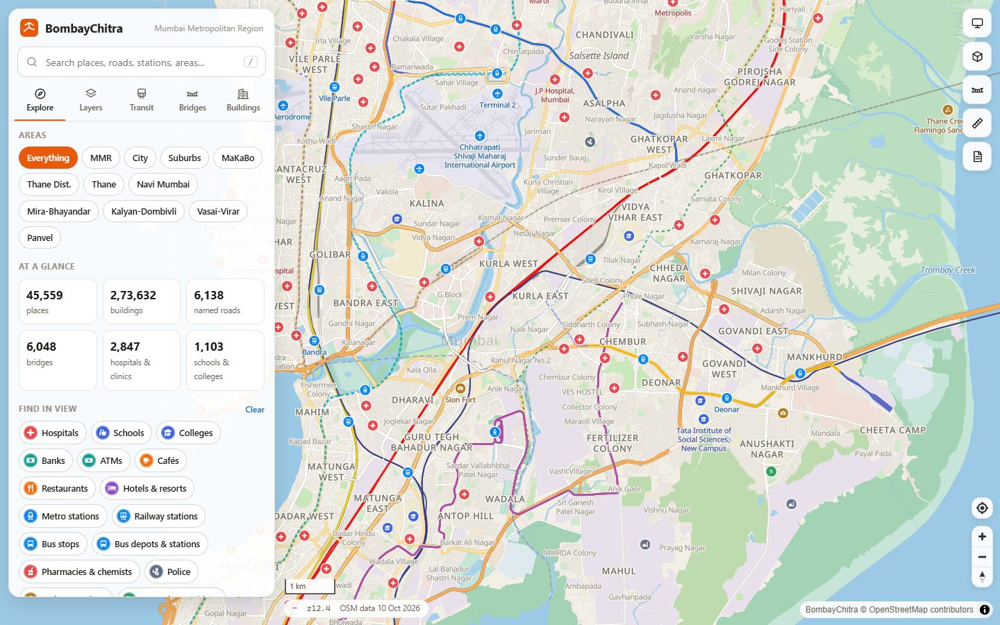
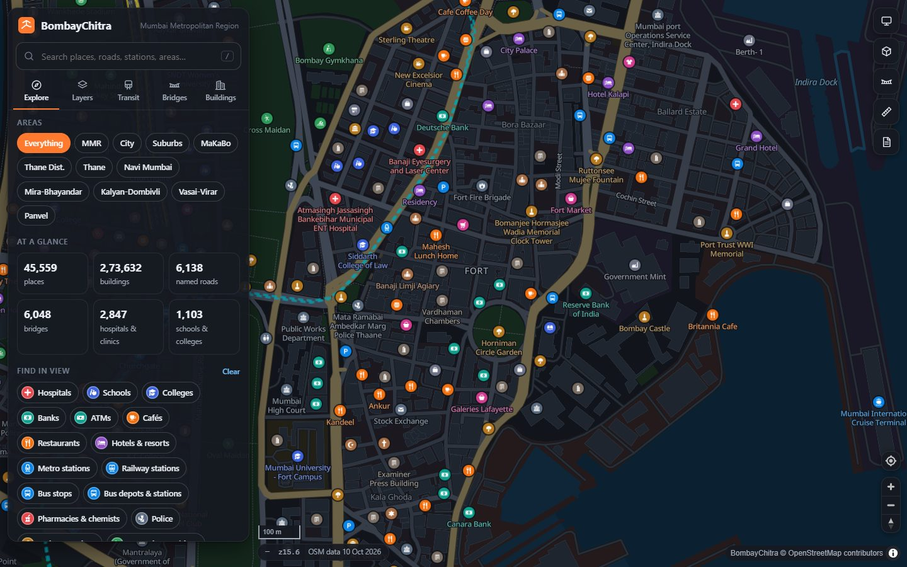
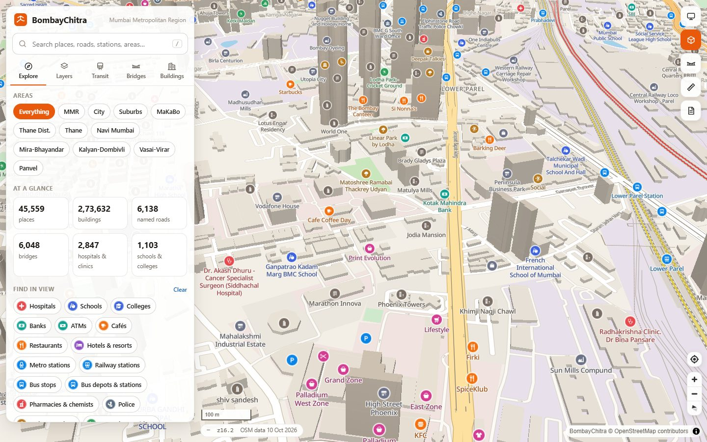
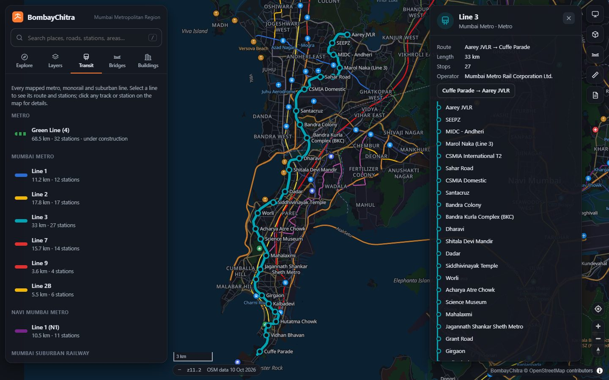
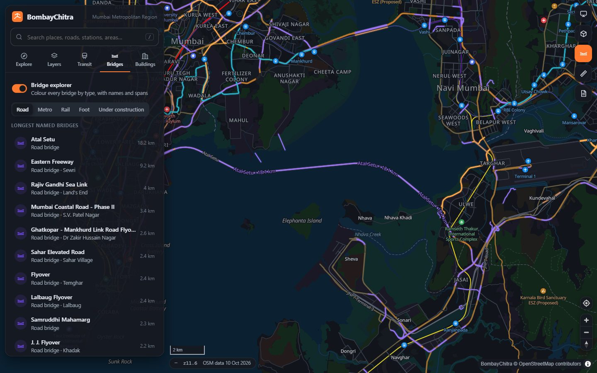

<div align="center">


# BombayChitra

**An open, detailed and fast map of the Mumbai Metropolitan Region — usable from any language, platform or product.**

Mumbai City · Mumbai Suburban · Thane District · Navi Mumbai · MaKaBo (Malad–Kandivali–Borivali) · the wider MMR

[](https://github.com/AmmaarBakshi/BombayChitra/actions/workflows/ci.yml)
[](LICENSE)
[](https://www.openstreetmap.org/copyright)

[Getting started](docs/getting-started.md) · [Documentation](docs/index.md) · [API](docs/api.md) · [Integrations](docs/integrations.md) · [Examples](examples/README.md)



</div>

## Features

- **Every road, pin-pointed** — expressways to footpaths with names, route numbers, lanes, speed limits, surface and
  one-way arrows. Click anywhere for the nearest named road, locality and area ("What's here?").
- **Advanced bridge mapping** — a dedicated layer for all 6,000+ bridge segments: sea links, freeways, flyovers,
  rail bridges, metro viaducts and foot over-bridges, with a bridge explorer and measured spans (Atal Setu 18.2 km,
  Eastern Freeway 9.2 km, Bandra–Worli Sea Link 4.0 km…).
- **Advanced building data** — 270,000+ footprints, 3D extrusion from validated heights and floor counts, the
  tallest towers, footprint area and per-area statistics.
- **All of transport** — Western, Central, Harbour, Trans-Harbour and Uran suburban lines; every metro line
  (1, 2A, 2B, 3, 4, 7, 9 and Navi Mumbai Line 1, including sections under construction) and the monorail in their
  official colours, with ordered stations; railway, metro and monorail stations, bus depots and 3,000+ bus stops.
- **Everything else** — ~45,000 places in 89 categories: hospitals, clinics, pharmacies, schools, colleges,
  universities, banks, ATMs, grounds and maidans, sports clubs and gymkhanas, cafés, restaurants, hotels, temples,
  mosques, churches, gurudwaras, agiaries, police, fire stations, post offices, malls, markets, offices and more.
- **Areas** — Mumbai City, Mumbai Suburban, MaKaBo, Thane District, Thane, Navi Mumbai, Mira-Bhayandar,
  Kalyan-Dombivli, Vasai-Virar and Panvel from official boundaries, for filtering and statistics.
- **Light and dark themes**, unified search with autocomplete, shareable links, a measuring tool and a mobile layout.
- **Use it anywhere** — REST API with an OpenAPI 3.1 spec, MapLibre styles for web, Android, iOS, Flutter and
  React Native, vector tiles for QGIS, a SQLite database any language can read, and GeoJSON/CSV exports.

<table>
  <tr>
    <td></td>
    <td></td>
  </tr>
  <tr>
    <td></td>
    <td></td>
  </tr>
</table>

## Quick start

Requirements: Java 21+, Go 1.26+, Node.js 22+.

```bash
git clone https://github.com/AmmaarBakshi/BombayChitra.git && cd BombayChitra
./scripts/build-data.sh                          # OpenStreetMap → tiles + database (~1 min)
(cd web && npm ci && npm run build)              # web app + docs, embedded into the server
(cd server && go build -o ../bin/bombaychitra ./cmd/bombaychitra)
./bin/bombaychitra serve                         # → http://localhost:8080
```

On Windows use `.\scripts\build-data.ps1`. With Docker: `docker compose run --rm pipeline && docker compose up -d server`.
See [Getting started](docs/getting-started.md) for details and prebuilt releases.

## Use it from your code

```bash
curl "http://localhost:8080/api/v1/search?q=lilavati%20hospital"
curl "http://localhost:8080/api/v1/nearby?lat=19.0178&lon=72.8478&radius=1000&category=atm,bank"
curl "http://localhost:8080/api/v1/reverse?lat=19.0545&lon=72.8405"
curl "http://localhost:8080/api/v1/places?area=makabo&category=college&format=geojson"
curl "http://localhost:8080/api/v1/transit/lines?mode=subway"
```

```js
// Any web page — the same styles work in MapLibre Native on Android and iOS
new maplibregl.Map({ container: 'map', style: 'http://localhost:8080/styles/dark.json' });
```

```python
import sqlite3  # or skip the server entirely and query the database
db = sqlite3.connect("file:data/build/bombaychitra.db?mode=ro", uri=True)
db.execute("SELECT name, phone FROM places WHERE category = 'hospital' LIMIT 5").fetchall()
```

Runnable examples for Python, JavaScript, Go, Java, C#, PHP, Ruby, Rust, R and SQL are in [`examples/`](examples/README.md).

## How it works

```text
OpenStreetMap ──► pipeline/ (Java + Planetiler, one pass) ──► bombaychitra.pmtiles  (vector tiles, 43 MB)
                                                         └──► bombaychitra.db       (SQLite: R*Tree + FTS5, 64 MB)
                                                                       │
                  server/ (Go, single static binary) ◄─────────────────┘
                  REST API · tiles · styles · web app · docs
                                │
                  web/ (TypeScript + MapLibre GL JS): map UI, light/dark styles, docs site
```

| Component | Stack | Why |
|---|---|---|
| [`pipeline/`](pipeline/README.md) | Java 25, [Planetiler](https://github.com/onthegomap/planetiler) | Fastest OSM → vector tile engine; builds tiles and database in ~65 s |
| [`server/`](server/README.md) | Go 1.26, pure-Go SQLite | One ~16 MB binary, no runtime dependencies, one disk read per tile |
| [`web/`](web/README.md) | TypeScript, MapLibre GL JS 6, Vite | 46 KB gzipped app code, GPU rendering, styles generated from one definition |
| `config/` | JSON | Region and place taxonomy shared by every component |
| `api/openapi.yaml` | OpenAPI 3.1 | Generate a typed client in any language |

Read more in [Architecture](docs/architecture.md).

## Documentation

The docs are served by the app at `/docs/` and are readable on GitHub:

| | |
|---|---|
| **Introduction** | [Overview](docs/index.md) · [Getting started](docs/getting-started.md) · [Architecture](docs/architecture.md) |
| **Data** | [Data & coverage](docs/data.md) · [Vector tiles](docs/tiles.md) · [Database](docs/database.md) · [Configuration](docs/configuration.md) |
| **Build & run** | [Pipeline](docs/pipeline.md) · [Server](docs/server.md) · [Deployment](docs/deployment.md) |
| **Use it** | [API guide](docs/api.md) · [API reference](api/openapi.yaml) · [Integrations](docs/integrations.md) · [Map styles](docs/styles.md) |
| **Project** | [Contributing](CONTRIBUTING.md) · [Licence](docs/license.md) |

## Contributing

Contributions are welcome — see [CONTRIBUTING.md](CONTRIBUTING.md). The easiest way to improve the map is to improve
[OpenStreetMap](https://www.openstreetmap.org): every detail card links to the feature so you can fix or add data.

## Licence

Code is [MIT](LICENSE). Map data © [OpenStreetMap contributors](https://www.openstreetmap.org/copyright), available
under the [ODbL](https://opendatacommons.org/licenses/odbl/). Fonts: Noto Sans (OFL). Icons: Maki (CC0).
